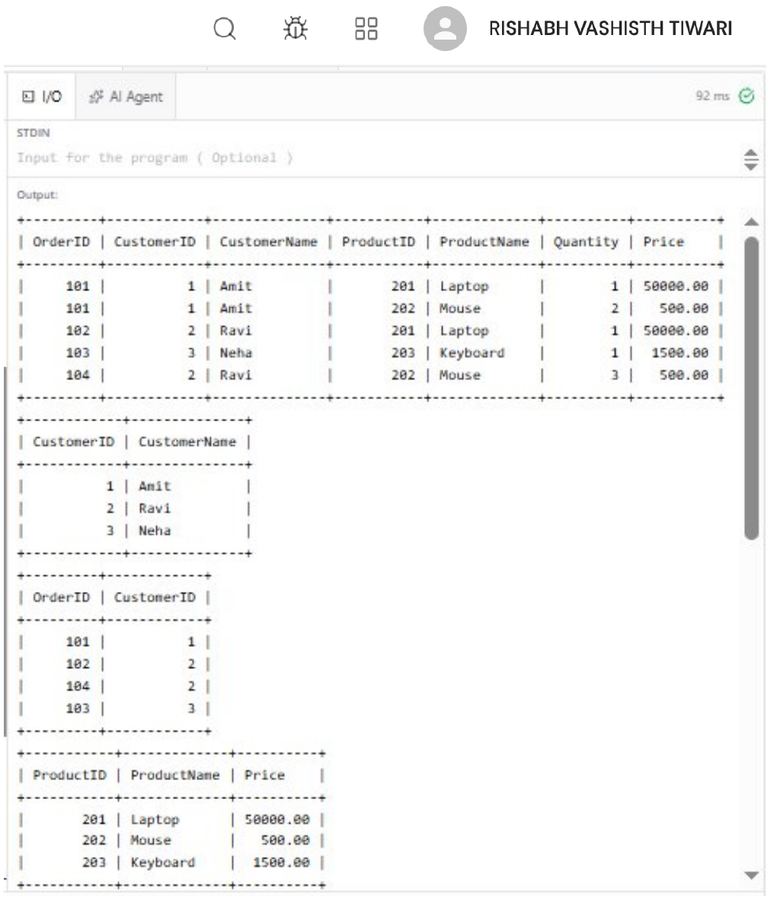
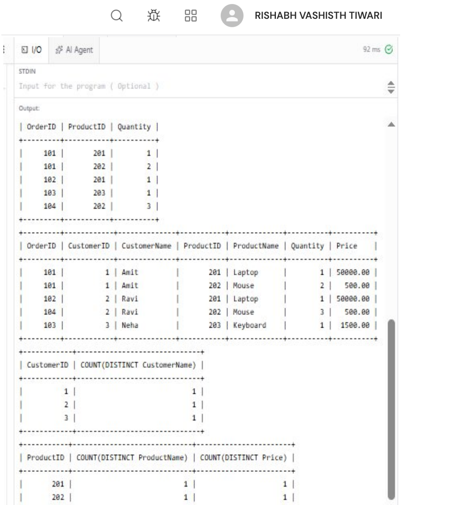

# EXPERIMENT - 7

## AIM
To identify functional dependencies in a denormalized Sales table and normalize it step-by-step from UNF to 3NF and BCNF. To verify lossless join and dependency preservation using SQL queries.

## OBJECTIVES
- To identify functional dependencies and candidate keys in a denormalized relational table.
- To demonstrate progressive normalization from Unnormalized Form (UNF) through 1NF, 2NF, 3NF, and Boyce-Codd Normal Form (BCNF).
- To eliminate insertion, update, and deletion anomalies by table decomposition.
- To verify that the decomposition is a **lossless join** using SQL `JOIN` operations.
- To verify **dependency preservation** across the decomposed tables using SQL queries.

## THEORY
Normalization is the systematic approach of decomposing tables to eliminate data redundancy and undesirable anomalies (insertion, update, and deletion anomalies).

- **Unnormalized Form (UNF):** A table structure containing repeating groups, multi-valued attributes, or composite fields.
- **First Normal Form (1NF):** Each attribute contains only atomic (indivisible) values, and each record is unique.
- **Second Normal Form (2NF):** The table is in 1NF and contains no **partial dependencies**—every non-prime attribute is fully functionally dependent on the entire primary key.
- **Third Normal Form (3NF):** The table is in 2NF and contains no **transitive dependencies**—no non-prime attribute depends on another non-prime attribute ($X \to Y$ and $Y \to Z$).
- **Boyce-Codd Normal Form (BCNF):** A stricter version of 3NF where for every non-trivial functional dependency $X \to Y$, the determinant $X$ must be a **superkey**.
- **Lossless Join Decomposition:** A decomposition of relation $R$ into $R_1, R_2, \dots, R_n$ is lossless if the natural join of all decomposed relations reconstructs the original relation $R$ without generating any spurious tuples:
  $$\Pi_{R_1}(R) \bowtie \Pi_{R_2}(R) = R$$
- **Dependency Preservation:** A decomposition preserves dependencies if the union of functional dependencies of all decomposed relations covers the closure of the original set of functional dependencies:
  $$(F_1 \cup F_2 \cup \dots \cup F_n)^+ = F^+$$

---

## DATABASE SETUP

```sql
CREATE DATABASE SalesDB;
USE SalesDB;
```

---

## SOURCE CODE / SQL QUERIES

### Step 1: Create the Denormalized Sales Table (UNF)

```sql
CREATE TABLE Sales (
    OrderID INT,
    CustomerID INT,
    CustomerName VARCHAR(50),
    ProductID INT,
    ProductName VARCHAR(50),
    Quantity INT,
    Price DECIMAL(10,2),
    PRIMARY KEY (OrderID, ProductID)
);
```

---

### Step 2: Insert Sample Data

```sql
INSERT INTO Sales VALUES
(101, 1, 'Amit', 201, 'Laptop', 1, 50000),
(101, 1, 'Amit', 202, 'Mouse', 2, 500),
(102, 2, 'Ravi', 201, 'Laptop', 1, 50000),
(103, 3, 'Neha', 203, 'Keyboard', 1, 1500),
(104, 2, 'Ravi', 202, 'Mouse', 3, 500);
```

---

### Step 3: Identify Functional Dependencies and Candidate Key

From the business logic and sample dataset, the following Functional Dependencies (FDs) are identified:
1. `OrderID → CustomerID`
2. `CustomerID → CustomerName`
3. `ProductID → { ProductName, Price }`
4. `{ OrderID, ProductID } → Quantity`

- **Primary / Candidate Key:** `{ OrderID, ProductID }`
- **Partial Dependencies (violating 2NF):**
  - `OrderID → CustomerID` (part of composite key determines CustomerID)
  - `ProductID → ProductName, Price` (part of composite key determines Product details)
- **Transitive Dependency (violating 3NF):**
  - `OrderID → CustomerID` and `CustomerID → CustomerName` (non-prime attribute depends on another non-prime attribute)

---

### Step 4: Convert UNF to 1NF

In 1NF, every attribute contains atomic values, each column has a unique name, and no repeating groups exist. The `Sales` table satisfies 1NF as each cell holds a single atomic value.

```sql
SELECT * FROM Sales;
```

---

### Step 5: Convert 1NF to 2NF (Eliminate Partial Dependencies)

To reach 2NF, eliminate partial functional dependencies by creating separate tables for Customers, Orders, Products, and OrderDetails:

```sql
CREATE TABLE Customers (
    CustomerID INT PRIMARY KEY,
    CustomerName VARCHAR(50)
);

CREATE TABLE Orders (
    OrderID INT PRIMARY KEY,
    CustomerID INT,
    FOREIGN KEY (CustomerID) REFERENCES Customers(CustomerID)
);

CREATE TABLE Products (
    ProductID INT PRIMARY KEY,
    ProductName VARCHAR(50),
    Price DECIMAL(10,2)
);

CREATE TABLE OrderDetails (
    OrderID INT,
    ProductID INT,
    Quantity INT,
    PRIMARY KEY (OrderID, ProductID),
    FOREIGN KEY (OrderID) REFERENCES Orders(OrderID),
    FOREIGN KEY (ProductID) REFERENCES Products(ProductID)
);
```

---

### Step 6: Convert 2NF to 3NF (Eliminate Transitive Dependencies)

In 3NF, transitive dependencies are removed. Since `CustomerName` depends directly on `CustomerID` rather than `OrderID`, isolating `Customers` ensures 3NF compliance.

Populate the normalized relations:

```sql
INSERT INTO Customers VALUES
(1, 'Amit'),
(2, 'Ravi'),
(3, 'Neha');

INSERT INTO Orders VALUES
(101, 1),
(102, 2),
(103, 3),
(104, 2);

INSERT INTO Products VALUES
(201, 'Laptop', 50000),
(202, 'Mouse', 500),
(203, 'Keyboard', 1500);

INSERT INTO OrderDetails VALUES
(101, 201, 1),
(101, 202, 2),
(102, 201, 1),
(103, 203, 1),
(104, 202, 3);
```

---

### Step 7: Convert 3NF to BCNF (Boyce-Codd Normal Form)

A relation is in BCNF if for every non-trivial functional dependency $X \to Y$, $X$ is a superkey.
- In `Customers`, `CustomerID` is a primary/superkey.
- In `Orders`, `OrderID` is a primary/superkey.
- In `Products`, `ProductID` is a primary/superkey.
- In `OrderDetails`, `(OrderID, ProductID)` is a primary/superkey.

All tables satisfy BCNF.

```sql
SELECT * FROM Customers;
SELECT * FROM Orders;
SELECT * FROM Products;
SELECT * FROM OrderDetails;
```

---

### Step 8: Verify Lossless Join

A decomposition is lossless if joining the decomposed tables reconstructs the original dataset without creating any spurious or phantom rows.

```sql
SELECT O.OrderID, C.CustomerID, C.CustomerName,
       P.ProductID, P.ProductName,
       OD.Quantity, P.Price
FROM Orders O
JOIN Customers C ON O.CustomerID = C.CustomerID
JOIN OrderDetails OD ON O.OrderID = OD.OrderID
JOIN Products P ON OD.ProductID = P.ProductID;
```

---

### Step 9: Verify Dependency Preservation

Functional dependencies can be verified on the decomposed relations by confirming that each determinant uniquely determines its dependent attributes (`COUNT(DISTINCT ...)` equals 1).

```sql
-- Verify CustomerID determines CustomerName
SELECT CustomerID, COUNT(DISTINCT CustomerName)
FROM Customers
GROUP BY CustomerID;

-- Verify ProductID determines ProductName and Price
SELECT ProductID, COUNT(DISTINCT ProductName), COUNT(DISTINCT Price)
FROM Products
GROUP BY ProductID;
```

---

## OUTPUT

### 1. UNF, 1NF, and 2NF Decomposition Output
Shows the initial denormalized `Sales` table alongside the decomposed `Customers`, `Orders`, and `Products` tables.



---

### 2. OrderDetails, Lossless Join & Dependency Preservation Verification Output
Displays the `OrderDetails` relation, verified lossless reconstruction via multi-table `JOIN`, and dependency preservation confirmation.



---

## RESULT
The denormalized `Sales` relation was analyzed, functional dependencies were identified, and the table was systematically normalized from **UNF to 1NF, 2NF, 3NF, and BCNF**. Both **lossless join** and **dependency preservation** properties were successfully verified using SQL queries.
