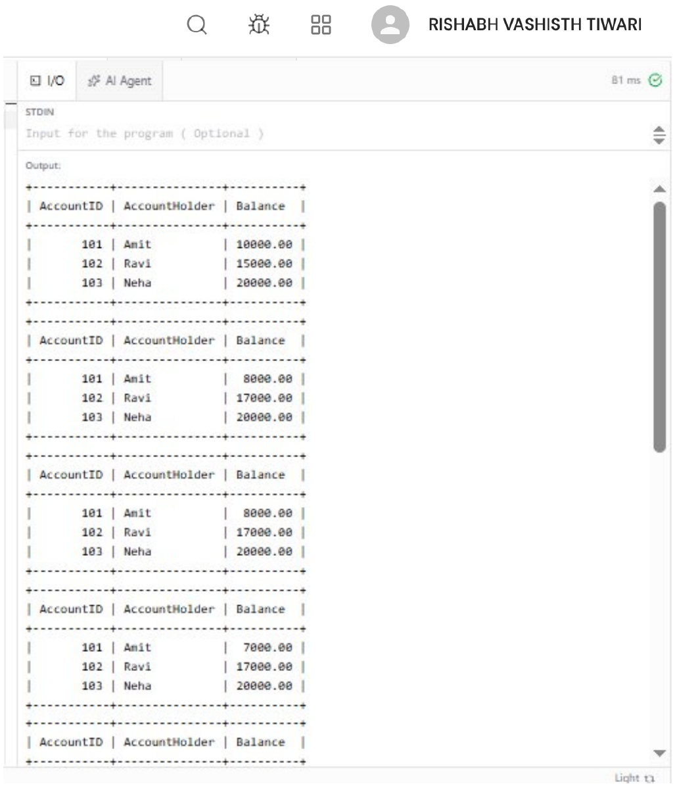
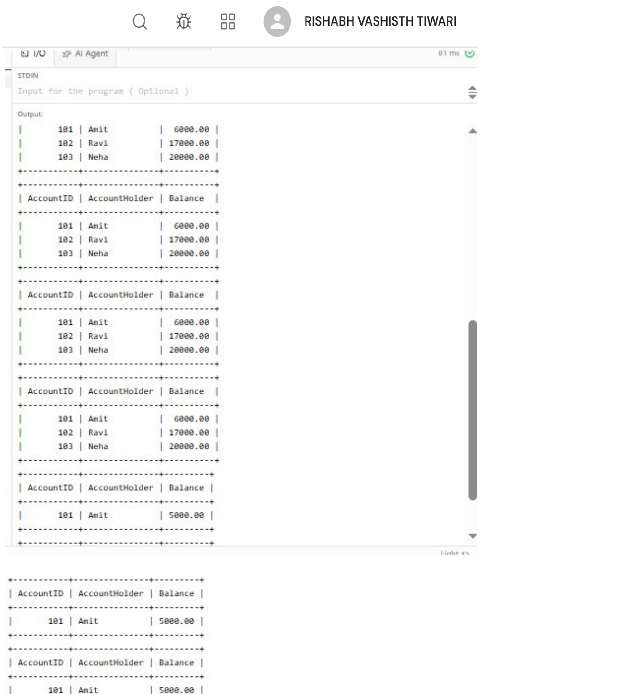

# EXPERIMENT - 8

## AIM
To implement banking-style transactions using BEGIN, COMMIT, ROLLBACK, and SAVEPOINT. To simulate partial failures and demonstrate isolation levels and concurrency anomalies using two sessions.

## OBJECTIVES
- To understand and demonstrate ACID properties (Atomicity, Consistency, Isolation, Durability) in a relational database.
- To execute transactional control commands: `START TRANSACTION`, `COMMIT`, `ROLLBACK`, and `SAVEPOINT`.
- To simulate partial transaction failures and roll back to intermediate savepoints.
- To configure and test transaction isolation levels (`READ UNCOMMITTED`, `READ COMMITTED`, `REPEATABLE READ`).
- To observe concurrency behaviors and anomalies across concurrent database sessions.

## THEORY
A **transaction** is a sequence of one or more database operations executed as a single logical unit of work.

### ACID Properties:
1. **Atomicity:** "All or nothing"—either all changes within a transaction are permanently saved, or the entire transaction is aborted and rolled back.
2. **Consistency:** A transaction takes the database from one valid state to another, maintaining all constraints, cascades, and rules.
3. **Isolation:** Concurrent transactions execute without interfering with one another. Intermediate, uncommitted states remain invisible to other transactions depending on the isolation level.
4. **Durability:** Once committed, transaction results survive system crashes or power failures.

### Transaction Commands:
- `START TRANSACTION` / `BEGIN`: Marks the beginning of a transactional boundary.
- `COMMIT`: Saves all operations executed within the transaction permanently to disk.
- `ROLLBACK`: Reverts all modifications made during the transaction to its beginning or to a designated savepoint.
- `SAVEPOINT <name>`: Sets a named marker within a transaction, allowing partial rollback via `ROLLBACK TO <name>`.

### Concurrency Anomalies & Isolation Levels:
- **Dirty Read:** A transaction reads uncommitted changes made by another transaction.
- **Non-Repeatable Read:** Re-reading the same row within a transaction yields different values because another committed transaction modified it.
- **Phantom Read:** Re-executing a range query returns new rows inserted by another committed transaction.

| Isolation Level | Dirty Read | Non-Repeatable Read | Phantom Read |
| :--- | :---: | :---: | :---: |
| **READ UNCOMMITTED** | Allowed | Allowed | Allowed |
| **READ COMMITTED** | Prevented | Allowed | Allowed |
| **REPEATABLE READ** (MySQL Default) | Prevented | Prevented | Prevented (InnoDB Next-Key Locks / MVCC) |
| **SERIALIZABLE** | Prevented | Prevented | Prevented |

---

## DATABASE SETUP

```sql
CREATE DATABASE BankingDB;
USE BankingDB;
```

---

## SOURCE CODE / SQL QUERIES

### Step 1: Create Database and Accounts Table

```sql
CREATE TABLE Accounts (
    AccountID INT PRIMARY KEY,
    AccountHolder VARCHAR(50),
    Balance DECIMAL(10,2) NOT NULL
);

INSERT INTO Accounts VALUES
(101, 'Amit', 10000.00),
(102, 'Ravi', 15000.00),
(103, 'Neha', 20000.00);

SELECT * FROM Accounts;
```

---

### Step 2: Demonstrate BEGIN and COMMIT (Atomic Fund Transfer)

Simulate a fund transfer of 2,000 from Amit (Account 101) to Ravi (Account 102) and commit the transaction.

```sql
START TRANSACTION;

UPDATE Accounts
SET Balance = Balance - 2000
WHERE AccountID = 101;

UPDATE Accounts
SET Balance = Balance + 2000
WHERE AccountID = 102;

COMMIT;

SELECT * FROM Accounts;
```

---

### Step 3: Demonstrate ROLLBACK

Simulate an aborted operation where 5,000 is debited from Amit, but the operation is discarded due to cancellation.

```sql
START TRANSACTION;

UPDATE Accounts
SET Balance = Balance - 5000
WHERE AccountID = 101;

ROLLBACK;

SELECT * FROM Accounts;
```

---

### Step 4: Demonstrate SAVEPOINT

Deduct 1,000 from Account 101, create a savepoint, attempt a deduction from Account 102, and roll back only to the savepoint before committing.

```sql
START TRANSACTION;

UPDATE Accounts
SET Balance = Balance - 1000
WHERE AccountID = 101;

SAVEPOINT sp1;

UPDATE Accounts
SET Balance = Balance - 2000
WHERE AccountID = 102;

ROLLBACK TO sp1;

COMMIT;

SELECT * FROM Accounts;
```

---

### Step 5: Simulate Partial Failure

```sql
START TRANSACTION;

UPDATE Accounts
SET Balance = Balance - 1000
WHERE AccountID = 101;

SAVEPOINT transfer_point;

UPDATE Accounts
SET Balance = Balance + 1000
WHERE AccountID = 102;

ROLLBACK TO transfer_point;

COMMIT;

SELECT * FROM Accounts;
```

---

### Step 6: Demonstrate Isolation Levels

Inspect and set session isolation levels:

```sql
-- Read Uncommitted (lowest isolation level)
SET SESSION TRANSACTION ISOLATION LEVEL READ UNCOMMITTED;
START TRANSACTION;
SELECT * FROM Accounts;
COMMIT;

-- Read Committed
SET SESSION TRANSACTION ISOLATION LEVEL READ COMMITTED;
START TRANSACTION;
SELECT * FROM Accounts;
COMMIT;

-- Repeatable Read (MySQL InnoDB default)
SET SESSION TRANSACTION ISOLATION LEVEL REPEATABLE READ;
START TRANSACTION;
SELECT * FROM Accounts;
COMMIT;
```

---

### Step 7: Demonstrate Concurrency Using Two Sessions

Open two concurrent MySQL client sessions connected to `BankingDB`.

#### Session 1:
```sql
START TRANSACTION;
UPDATE Accounts
SET Balance = Balance - 1000
WHERE AccountID = 101;

SELECT * FROM Accounts WHERE AccountID = 101;
-- Do NOT commit yet
```

#### Session 2 (Concurrent execution while Session 1 is uncommitted):
```sql
START TRANSACTION;
SELECT * FROM Accounts WHERE AccountID = 101;
COMMIT;
```

#### Session 1 (Finalize transaction):
```sql
COMMIT;
```

---

## OUTPUT

### 1. Initial State, COMMIT, ROLLBACK, and SAVEPOINT Execution
Demonstrates initial accounts balance, committed balance update, rolled back update, and savepoint partial rollback.



---

### 2. Partial Failure Simulation and Multi-Session Concurrency
Demonstrates the partial failure recovery mechanism alongside session isolation levels and concurrency validation.



---

## RESULT
Banking transactions were successfully implemented using `START TRANSACTION`, `COMMIT`, `ROLLBACK`, and `SAVEPOINT`. Transaction atomicity, partial rollback recovery, transaction isolation levels, and multi-session concurrency behavior were analyzed and verified.
