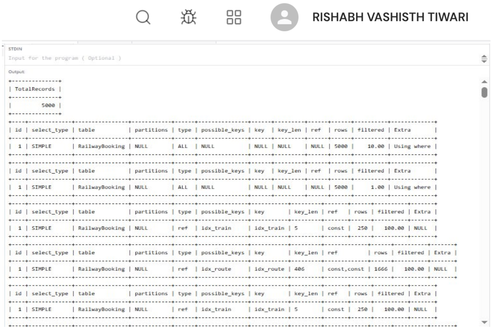
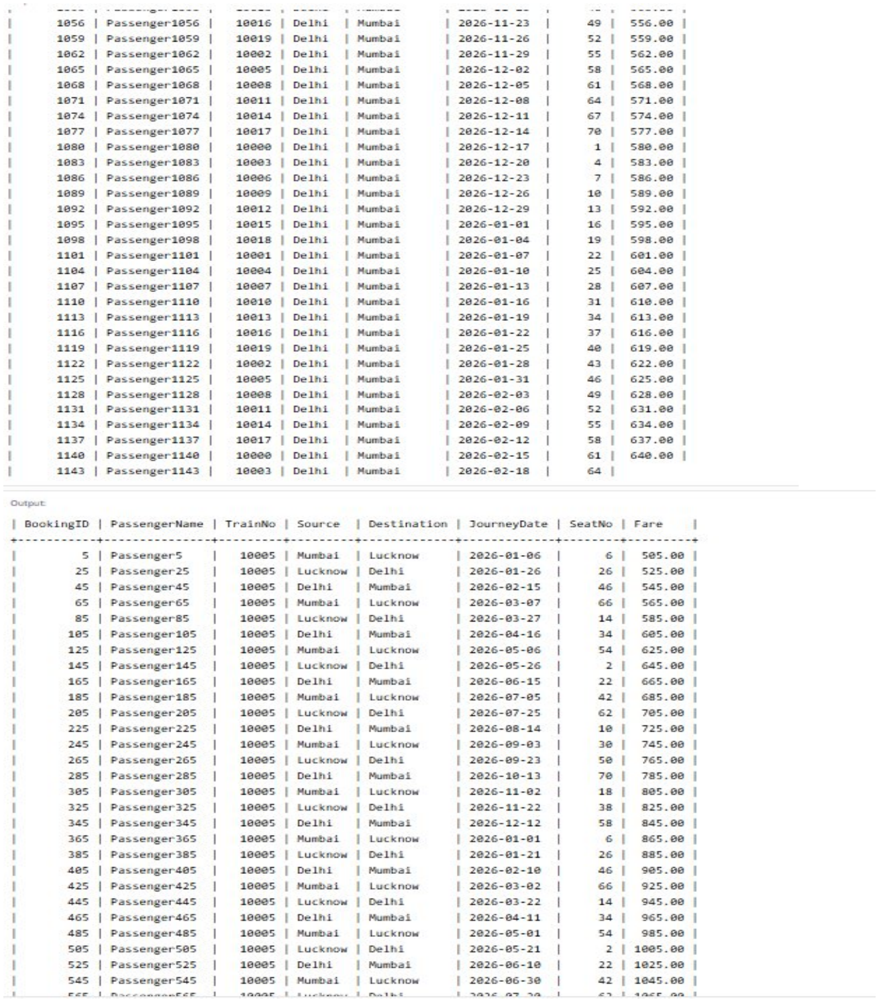

# EXPERIMENT - 9

## AIM
To create a Railway Booking table with at least 5,000 records and benchmark query performance before and after creating single and composite indexes. To compare execution plans using EXPLAIN.

## OBJECTIVES
- To design and generate a large relational dataset (5,000+ records) using an automated MySQL stored procedure.
- To analyze query execution plans using the `EXPLAIN` command.
- To create single-column and composite B-tree indexes.
- To compare execution metrics before and after indexing (scan type, estimated rows examined, key chosen).
- To profile and compare exact execution times using MySQL query profiling (`SET PROFILING = 1; SHOW PROFILES;`).

## THEORY
An **index** is a database data structure (typically a B+ Tree in MySQL InnoDB) that provides fast pointers to rows, minimizing the number of disk I/O operations required to satisfy a query.

### Types of Indexes:
1. **Single-Column Index:** An index created on a single attribute (e.g., `TrainNo`). Ideal for queries filtering on that specific column.
2. **Composite (Multi-Column) Index:** An index created on two or more columns (e.g., `(Source, Destination)`). Follows the **leftmost prefix rule**—the index can be used for queries filtering on the leftmost column alone or on combinations of columns in left-to-right order.

### EXPLAIN Output Key Attributes:
- **`select_type`:** Type of query (e.g., `SIMPLE`, `PRIMARY`, `SUBQUERY`).
- **`type` (Access Type):** Indicates how MySQL searches for rows. Ranked from worst to best:
  - `ALL`: Full table scan (reads every single row in the table).
  - `index`: Full index scan.
  - `range`: Range scan using an index (e.g., `>`, `<`, `BETWEEN`, `IN`).
  - `ref`: Non-unique index lookup (returns multiple matching rows).
  - `eq_ref`: Unique index lookup with joins.
  - `const` / `system`: Constant lookup by primary or unique key (fastest, $O(1)$).
- **`possible_keys`:** Candidate indexes that MySQL could potentially use.
- **`key`:** The actual index selected by the MySQL query optimizer.
- **`key_len`:** Byte length of the selected index key.
- **`rows`:** Estimated number of rows MySQL must examine to produce the result. Lower is better.
- **`filtered`:** Percentage of examined rows that satisfy query conditions (100% is optimal).
- **`Extra`:** Additional diagnostic info (e.g., `Using where`, `Using index`, `Using filesort`, `Using temporary`).

---

## DATABASE SETUP

```sql
CREATE DATABASE RailwayDB;
USE RailwayDB;
```

---

## SOURCE CODE / SQL QUERIES

### Step 1: Create Database and RailwayBooking Table

```sql
CREATE TABLE RailwayBooking (
    BookingID INT PRIMARY KEY,
    PassengerName VARCHAR(50),
    TrainNo INT,
    Source VARCHAR(50),
    Destination VARCHAR(50),
    JourneyDate DATE,
    SeatNo INT,
    Fare DECIMAL(10,2)
);
```

---

### Step 2: Insert 5,000 Records via Stored Procedure

```sql
DELIMITER //
CREATE PROCEDURE GenerateBookings()
BEGIN
    DECLARE i INT DEFAULT 1;
    WHILE i <= 5000 DO
        INSERT INTO RailwayBooking VALUES (
            i,
            CONCAT('Passenger', i),
            10000 + (i MOD 20),
            CASE
                WHEN i MOD 3 = 0 THEN 'Delhi'
                WHEN i MOD 3 = 1 THEN 'Lucknow'
                ELSE 'Mumbai'
            END,
            CASE
                WHEN i MOD 3 = 0 THEN 'Mumbai'
                WHEN i MOD 3 = 1 THEN 'Delhi'
                ELSE 'Lucknow'
            END,
            DATE_ADD('2026-01-01', INTERVAL (i MOD 365) DAY),
            1 + (i MOD 72),
            500 + (i MOD 1000)
        );
        SET i = i + 1;
    END WHILE;
END //
DELIMITER ;

CALL GenerateBookings();

SELECT COUNT(*) AS TotalRecords FROM RailwayBooking;
```

---

### Step 3: Check Query Performance Before Indexing (Full Table Scans)

#### Query 1: Single-column filter (`TrainNo = 10005`)
```sql
EXPLAIN
SELECT *
FROM RailwayBooking
WHERE TrainNo = 10005;
```

#### Query 2: Multi-column filter (`Source = 'Delhi' AND Destination = 'Mumbai'`)
```sql
EXPLAIN
SELECT *
FROM RailwayBooking
WHERE Source = 'Delhi'
AND Destination = 'Mumbai';
```

---

### Step 4: Create Single-Column Index and Analyze Performance

Create a single-column B-tree index on `TrainNo`:

```sql
CREATE INDEX idx_train ON RailwayBooking(TrainNo);

EXPLAIN
SELECT *
FROM RailwayBooking
WHERE TrainNo = 10005;
```

---

### Step 5: Create Composite Index and Analyze Performance

Create a composite index on `(Source, Destination)`:

```sql
CREATE INDEX idx_route ON RailwayBooking(Source, Destination);

EXPLAIN
SELECT *
FROM RailwayBooking
WHERE Source = 'Delhi'
AND Destination = 'Mumbai';
```

---

### Step 6: Comparative Performance Summary

| Metric | Query 1 (TrainNo) Before Index | Query 1 After `idx_train` | Query 2 (Route) Before Index | Query 2 After `idx_route` |
| :--- | :---: | :---: | :---: | :---: |
| **Access Type (`type`)** | `ALL` | `ref` | `ALL` | `ref` |
| **Selected Key (`key`)** | `NULL` | `idx_train` | `NULL` | `idx_route` |
| **Rows Examined** | 5,000 | 250 | 5,000 | 1,666 |
| **Filtered %** | 10.00% | 100.00% | 1.00% | 100.00% |

---

### Step 7: Measure Query Execution Time via Profiling

```sql
SET PROFILING = 1;

SELECT *
FROM RailwayBooking
WHERE TrainNo = 10005;

SELECT *
FROM RailwayBooking
WHERE Source = 'Delhi'
AND Destination = 'Mumbai';

SHOW PROFILES;
```

---

### Step 8: Display Booking Records

```sql
SELECT *
FROM RailwayBooking
LIMIT 10;
```

---

## OUTPUT

### 1. Total Records and EXPLAIN Analysis Before & After Indexing
Shows the 5,000 record count and execution plan transformations from full table scans (`ALL`) to indexed lookups (`ref`).



---

### 2. Sample Booking Records & Filtered Results
Displays sample retrieved rows from `RailwayBooking` matching indexed route and train criteria.



---

## RESULT
A Railway Booking dataset containing 5,000 records was generated. Query execution plans and execution times were evaluated using `EXPLAIN` and `SHOW PROFILES`. Creating single-column and composite indexes transformed costly full table scans (`ALL`) into efficient indexed lookups (`ref`), drastically reducing the rows examined and accelerating query response times.
