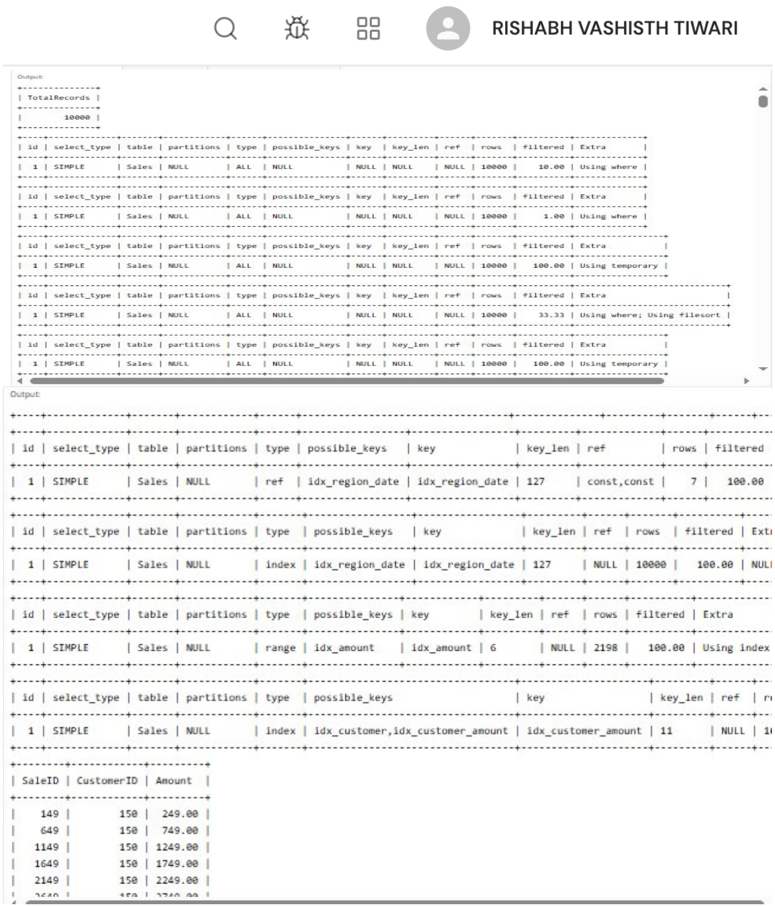
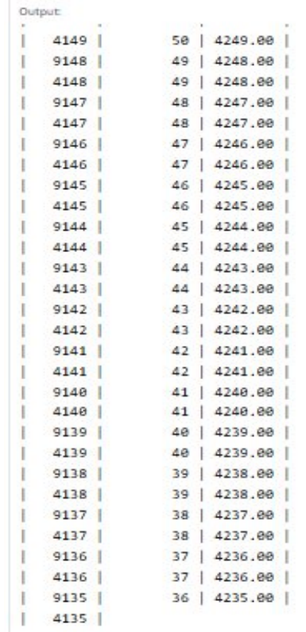

# EXPERIMENT - 10

## AIM
To generate a dataset with at least 10,000 rows, write five slow queries, analyze them using EXPLAIN, optimize them using indexing and query rewriting, and compare execution time before and after optimization.

## OBJECTIVES
- To synthesize a 10,000+ row transactional dataset using a stored procedure in MySQL.
- To formulate five common unoptimized SQL query patterns (unindexed filters, wide wildcard projections, aggregation on unindexed groupings, ordering unindexed columns).
- To analyze execution bottlenecks using `EXPLAIN` (identifying `ALL` scans, `Using temporary`, and `Using filesort`).
- To optimize queries through targeted B-tree indexing and query rewriting (narrow projection, covering indexes, composite indexing).
- To quantify performance enhancements before and after optimization using query profiling.

## THEORY
**Query Optimization** is the process of tuning queries and database structures so that the Relational Database Management System (RDBMS) executes them in the most resource-efficient manner.

### Optimization Principles Applied:
1. **Avoid `SELECT *` (Projection Optimization):** Retrieving only required columns reduces memory footprint, network transfer payload, and allows MySQL to leverage covering indexes.
2. **Eliminate Full Table Scans:** Adding B-Tree indexes on high-cardinality predicate columns allows $O(\log N)$ point and range lookups.
3. **Covering Indexes:** When an index contains all the columns requested in the `SELECT`, `WHERE`, and `GROUP BY` clauses, MySQL satisfies the query directly from index memory without touching table data pages (`Using index`).
4. **Composite Indexing & Ordering:** Creating indexes that match both filtering and sorting predicates eliminates expensive in-memory sort passes (`Using filesort`) and temporary tables (`Using temporary`).

---

## DATABASE SETUP

```sql
CREATE DATABASE OptimizationDB;
USE OptimizationDB;
```

---

## SOURCE CODE / SQL QUERIES

### Step 1: Create Database and Sales Table

```sql
CREATE TABLE Sales (
    SaleID INT PRIMARY KEY,
    CustomerID INT,
    ProductID INT,
    Region VARCHAR(30),
    Quantity INT,
    Amount DECIMAL(10,2),
    SaleDate DATE
);
```

---

### Step 2: Generate 10,000 Records via Stored Procedure

```sql
DELIMITER //
CREATE PROCEDURE GenerateSales()
BEGIN
    DECLARE i INT DEFAULT 1;
    WHILE i <= 10000 DO
        INSERT INTO Sales VALUES (
            i,
            1 + (i MOD 500),
            1 + (i MOD 100),
            CASE
                WHEN i MOD 4 = 0 THEN 'North'
                WHEN i MOD 4 = 1 THEN 'South'
                WHEN i MOD 4 = 2 THEN 'East'
                ELSE 'West'
            END,
            1 + (i MOD 10),
            100 + (i MOD 5000),
            DATE_ADD('2025-01-01', INTERVAL (i MOD 365) DAY)
        );
        SET i = i + 1;
    END WHILE;
END //
DELIMITER ;

CALL GenerateSales();

SELECT COUNT(*) AS TotalRecords FROM Sales;
```

---

### Step 3: Five Slow Queries and Their EXPLAIN Analysis (Before Optimization)

#### Query 1: Filter by CustomerID with `SELECT *`
```sql
EXPLAIN
SELECT * FROM Sales
WHERE CustomerID = 150;
```
- **Bottleneck:** Full table scan (`type: ALL`, `rows: 10000`, `Extra: Using where`).

#### Query 2: Filter by Region and SaleDate with `SELECT *`
```sql
EXPLAIN
SELECT * FROM Sales
WHERE Region = 'North'
AND SaleDate = '2025-03-15';
```
- **Bottleneck:** Full table scan on two unindexed predicates (`type: ALL`, `rows: 10000`).

#### Query 3: Calculate Total Sales by Region
```sql
EXPLAIN
SELECT Region, SUM(Amount)
FROM Sales
GROUP BY Region;
```
- **Bottleneck:** Requires temporary table for grouping (`type: ALL`, `rows: 10000`, `Extra: Using temporary`).

#### Query 4: Filter by Amount and Sort Descending
```sql
EXPLAIN
SELECT * FROM Sales
WHERE Amount > 4000
ORDER BY Amount DESC;
```
- **Bottleneck:** Full table scan coupled with disk/memory file sort (`type: ALL`, `rows: 10000`, `Extra: Using where; Using filesort`).

#### Query 5: Group by CustomerID with HAVING Threshold
```sql
EXPLAIN
SELECT CustomerID, SUM(Amount) AS TotalSales
FROM Sales
GROUP BY CustomerID
HAVING SUM(Amount) > 10000;
```
- **Bottleneck:** Scans entire table and constructs temporary grouping table (`type: ALL`, `rows: 10000`, `Extra: Using temporary`).

---

### Step 4: Optimize Using Indexing

Create targeted single-column, composite, and covering indexes:

```sql
-- For Query 1
CREATE INDEX idx_customer ON Sales(CustomerID);

-- For Query 2
CREATE INDEX idx_region_date ON Sales(Region, SaleDate);

-- For Query 4
CREATE INDEX idx_amount ON Sales(Amount);

-- For Query 5 (Covering index for CustomerID and Amount)
CREATE INDEX idx_customer_amount ON Sales(CustomerID, Amount);
```

---

### Step 5: Rewrite Queries for Maximum Performance

Rewrite each query to eliminate `SELECT *`, request only strictly required columns, and utilize covering indexes.

#### Optimized Query 1: Narrow projection + Index lookup
```sql
EXPLAIN
SELECT SaleID, CustomerID, Amount
FROM Sales
WHERE CustomerID = 150;
```

#### Optimized Query 2: Filter by Composite Index
```sql
EXPLAIN
SELECT SaleID, Region, SaleDate, Amount
FROM Sales
WHERE Region = 'North'
AND SaleDate = '2025-03-15';
```

#### Optimized Query 3: Regional Summary
```sql
EXPLAIN
SELECT Region, SUM(Amount)
FROM Sales
GROUP BY Region;
```

#### Optimized Query 4: Index Range Scan on Amount
```sql
EXPLAIN
SELECT SaleID, ProductID, Amount
FROM Sales
WHERE Amount > 4000
ORDER BY Amount DESC;
```

#### Optimized Query 5: Covering Index Grouping
```sql
EXPLAIN
SELECT CustomerID, SUM(Amount) AS TotalSales
FROM Sales
GROUP BY CustomerID
HAVING SUM(Amount) > 10000;
```

---

### Step 6: Measure Execution Time via Query Profiling

```sql
SET PROFILING = 1;

SELECT SaleID, CustomerID, Amount
FROM Sales
WHERE CustomerID = 150;

SELECT SaleID, Region, SaleDate, Amount
FROM Sales
WHERE Region = 'North'
AND SaleDate = '2025-03-15';

SELECT Region, SUM(Amount)
FROM Sales
GROUP BY Region;

SELECT SaleID, ProductID, Amount
FROM Sales
WHERE Amount > 4000
ORDER BY Amount DESC;

SELECT CustomerID, SUM(Amount) AS TotalSales
FROM Sales
GROUP BY CustomerID
HAVING SUM(Amount) > 10000;

SHOW PROFILES;
```

---

### Step 7: Verify Dataset and Optimized Sample Results

```sql
SELECT COUNT(*) AS TotalRows FROM Sales;
SELECT * FROM Sales LIMIT 10;
```

---

## OUTPUT

### 1. Slow Query EXPLAIN vs Optimized Execution Plans
Demonstrates the 10,000-row table scan diagnosis, followed by index-driven plan improvements (`ref`, `range`, `index`).



---

### 2. Optimized Query Result Dataset
Displays sample retrieved rows from the optimized query runs.



---

## RESULT
A dataset of 10,000 records was generated in MySQL. Five unoptimized queries were analyzed using `EXPLAIN` and shown to cause full table scans (`ALL`), temporary table generation, and file sorts. By constructing single-column, composite, and covering indexes along with rewriting queries to eliminate `SELECT *`, query execution plans transitioned to `ref`, `range`, and `index` scan types, dramatically reducing rows examined and execution latency.
